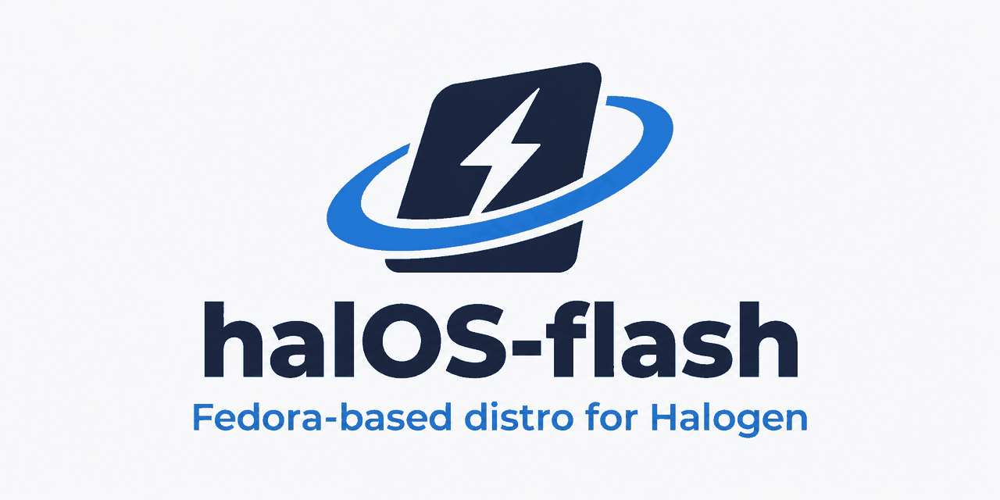

<div align="center">



**An operating system made for one job: to run Halogen.**

[](https://github.com/n4berius/halos-flash/actions/workflows/build.yml)
[](https://github.com/n4berius/halos-flash/actions/workflows/iso.yml)
[](https://github.com/n4berius/halos-flash/releases)
[](https://github.com/n4berius/halos-flash/pkgs/container/halos-flash)
[](https://docs.fedoraproject.org/en-US/bootc/)
[](LICENSE)

[](INSTALL.md)
[](docs/GUIDE.md)
[](docs/CLI.md)
[](docs/CLIENTS.md)
[](https://github.com/n4berius/halos-flash/releases)

</div>

halOS is an image-based Fedora 45 appliance for one 128 GB AMD Strix Halo machine. You install
it from USB. It starts with Secure Boot on and runs
[halogen-flash-server](https://github.com/peonist-ai/halogen-flash-server) ("Halogen") at one
pinned release, with or without its NPU models. The host is already configured. There is no
desktop after the installation.

## Highlights

- 🔒 **Secure from the start:** Secure Boot, a LUKS-encrypted disk that unlocks with the TPM, a
  tang server or SSH, and signed images that the machine checks before each update.
- 🔁 **Safe updates:** `sudo halosctl upgrade` installs a new image, and
  `sudo halosctl rollback` goes back to the previous one.
- 🧠 **Flash and NPU models:** the pinned Halogen release, its models, and your own checkpoints.
- 🌐 **Ready for clients:** an OpenAI-compatible API on port 8731, with HTTPS when you want it.
- 📊 **Live dashboard** on port 8732, and a `halogenctl selftest` for the hardware.
- 🛡️ **Hardened:** fail2ban, audit logs, and Halogen in a rootless container with no network
  access out.

> [!NOTE]
> **Status:** both editions build, install and boot in a virtual machine with Secure Boot on.
> Since `v0.20.0`, both editions also run on a real Strix Halo machine, with the GPU, the NPU
> and the model download. LUKS with TPM unlock works there too. For the details, see
> [Tested hardware](INSTALL.md#tested-hardware).

halOS is an independent project, formerly called halogen-bootc. It runs Halogen unmodified, and
is not made, endorsed or supported by Peonist, LLC. "halogen" is a trademark of Peonist, LLC
([trademark policy](https://github.com/peonist-ai/halogen-flash-server/blob/main/TRADEMARKS.md)).
For problems with this OS, use this repository's issues. Report problems in Halogen itself
to [Halogen](https://github.com/peonist-ai/halogen-flash-server/issues) only if you can
reproduce them on a supported host.

## AI usage disclaimer

> [!IMPORTANT]
> The code, tests, CI workflows and documentation in this repository were written entirely by
> [Claude](https://claude.ai), Anthropic's AI model, working from direction given by the
> repository owner, [n4berius](https://github.com/n4berius). n4berius reviewed and merged the
> code. AI-written software can contain mistakes. Read it and test it on your own hardware
> before you rely on it. This software comes with no warranty, as stated in the
> [license](LICENSE).

## Install

See **[INSTALL.md](INSTALL.md)**. In short:

1. Write the ISO for your edition to a USB drive.
2. Start the machine from the USB drive.
3. Answer the guided installer's few questions: the disk, LUKS or not, root or not, and your
   admin account.
4. Run `sudo halosctl setup`.
5. Let the first boot download the models.

After that, clients use `http://<host>:8731/v1` (or `https://` with HTTPS on) with the key that
`sudo halogenctl api-key` prints. A live dashboard is at `http://<host>:8732`.

## Documentation

| Guide | What's in it |
|---|---|
| [INSTALL.md](INSTALL.md) | The installation, the first boot and the disk unlock |
| [docs/GUIDE.md](docs/GUIDE.md) | How to use the machine: settings, updates, HTTPS, the dashboard, benchmarks, your own checkpoints, logs, and the reasons for each feature |
| [docs/CLI.md](docs/CLI.md) | Every `halosctl`, `halogenctl` and `halogen-enroll-tpm` command |
| [docs/CLIENTS.md](docs/CLIENTS.md) | How to connect apps and coding agents, and how to trust halOS's certificate |
| [BUILDING.md](BUILDING.md), [RELEASING.md](RELEASING.md), [CONTRIBUTING.md](CONTRIBUTING.md) | How to build halOS yourself, publish a release, and contribute |
| [CHANGELOG.md](CHANGELOG.md), [ROADMAP.md](ROADMAP.md) | What each release changed, and what comes next |
| [SECURITY.md](SECURITY.md) | How to report a security problem, and the limits of the protection |

## Editions

| | With NPU | Without NPU |
|---|---|---|
| Image | `halos-flash:0.20.7` | `halos-flash:0.20.7-no-npu` |
| Serves | Flash and NPU models | Flash only |
| IOMMU | On (`iommu=pt`), which the NPU needs | Off (`amd_iommu=off`), for 13-16% more prefill (Halogen's measurement) |

`sudo halosctl npu off` and `npu on` change the edition without a new install.
[Choose an edition](INSTALL.md#1-choose-an-edition) tells the other differences, and the security
trade-off of the IOMMU.

## Releases

Each release is a git tag, such as `v0.20.7-2-alpha`, and an image tag of the same name without
the `v`.
[RELEASING.md](RELEASING.md) defines the channels and the names.

| Use | Image tag |
|---|---|
| Recommended | `stable`, or a version such as `0.20.7` |
| Test a release | `rc`, or an exact tag such as `0.20.7-2-alpha` |
| Earliest tests | `alpha` |
| Newest `main` build | `edge` |
| Newest `main` build with a test kernel (a Linux 7.4 release candidate) | `kernel-next` |

For the edition without the NPU, add `-no-npu`. A machine follows a channel with
`sudo halosctl switch` and updates with `sudo halosctl upgrade`
([details](docs/GUIDE.md#updates-and-rollback)). Each Monday, a workflow builds the newest stable
release again with the Fedora updates.

## How it follows Halogen

This project follows the official
[halogen-flash-server](https://github.com/peonist-ai/halogen-flash-server). It does not fork
or change it.

- Each image tag names the Halogen release that it contains.
- `versions.env` pins that release, the commit that it matches, and the hashes of the files
  that the build takes from it. The build then pins the container by digest. So every build runs
  the same container until someone changes the pin on purpose.
- The container runs unmodified. The machine pulls it from Halogen's own registry on the
  first boot.
- The list of allowed options comes from Halogen's `docs/FLAGS.md`.

This project does not take new Halogen releases automatically. Each release is a reviewed
change to `versions.env`, so this project can be behind upstream.

Halogen's own documentation is the reference for each setting and for how the server operates.
This repository gives only what halOS adds or changes. If the two disagree about Halogen, follow
Halogen's documentation for your version:

<details>
<summary>Halogen's official documentation</summary>

| Topic | Official documentation |
|---|---|
| Every setting | [`docs/FLAGS.md`](https://github.com/peonist-ai/halogen-flash-server/blob/main/docs/FLAGS.md) |
| Configuration and memory | [`docs/configuration.md`](https://github.com/peonist-ai/halogen-flash-server/blob/main/docs/configuration.md) |
| NPU models and host needs | [`docs/NPU.md`](https://github.com/peonist-ai/halogen-flash-server/blob/main/docs/NPU.md) |
| API | [`docs/api.md`](https://github.com/peonist-ai/halogen-flash-server/blob/main/docs/api.md) |
| Host setup | [`docs/host-setup.md`](https://github.com/peonist-ai/halogen-flash-server/blob/main/docs/host-setup.md) |
| Troubleshooting | [`docs/troubleshooting.md`](https://github.com/peonist-ai/halogen-flash-server/blob/main/docs/troubleshooting.md) |
| Changes between releases | [`CHANGELOG.md`](https://github.com/peonist-ai/halogen-flash-server/blob/main/CHANGELOG.md) |

These links show Halogen's newest code, which can be newer than the version that halOS pins.
For an exact match, open the same file at the commit in `versions.env`.

</details>

Base image: Fedora's official `quay.io/fedora/fedora-bootc:45`. Fedora has no separate
image-based Server edition, so halOS adds only what the appliance needs. Each build records the
exact base and packages that it used ([BUILDING.md](BUILDING.md#3-build-the-os-image)).

## Build

To build the image or the ISO yourself, follow [BUILDING.md](BUILDING.md). In short:

```bash
tests/run.sh
sudo scripts/build.sh        # the OS image
sudo scripts/build-iso.sh    # the USB installer, under output/
```

A push to `main` publishes the `edge` images. A release publishes its own tags. A change to the
image or the installer also starts the full ISO installation test.

## Name

Halogen's trademark policy does not allow "halogen" in another machine-learning product or
project name without written permission. So the project changed its name from halogen-bootc to
halOS. The policy lets halOS say that it runs Halogen.

## License

This project's own files are under the [MIT license](LICENSE). That license does not cover
Halogen, model weights, or the other components in the images. They keep their own terms,
listed in [`THIRD-PARTY-NOTICES.md`](THIRD-PARTY-NOTICES.md). halOS builds in two tools by
Quaternion ([Quat3rnion](https://github.com/Quat3rnion)):
[halogen-dashboard](https://github.com/Quat3rnion/halogen-dashboard) and
[bf16-to-hgn](https://github.com/Quat3rnion/bf16-to-hgn), both MIT or Apache-2.0. Thank you.
Halogen's [EULA](https://github.com/peonist-ai/halogen-flash-server/blob/main/LICENSE.md)
applies to Halogen.
